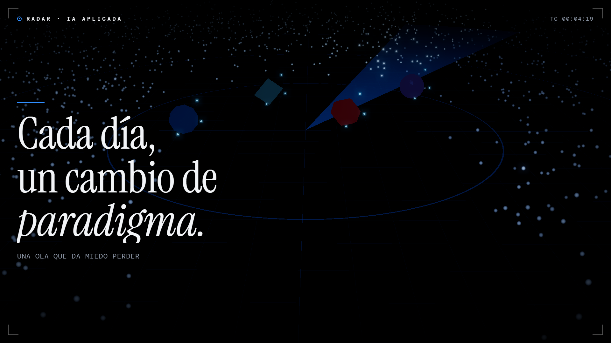
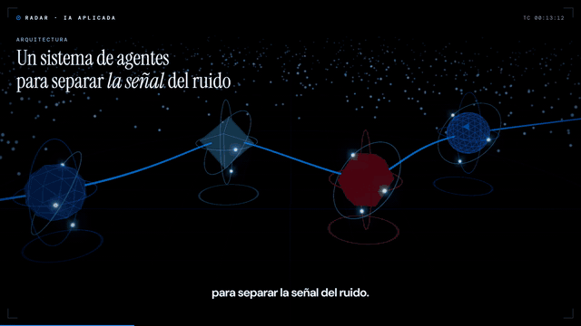

# Radar · IA aplicada

En inteligencia artificial, cada día parece un cambio de paradigma. Este repositorio es el sistema de agentes que uso para no ir detrás de todo: cada mañana revisa cientos de repositorios y modelos nuevos, se queda con los diez que más impacto tienen en mi trabajo y me los explica con vídeo, lámina y un quick win concreto.

## Cómo funciona

| Pieza | Qué hace | Dónde |
|---|---|---|
| Rastreador | Recorre GitHub y Hugging Face, descarta lo ya visto y puntúa cada novedad con una cascada de interés de 5 niveles (corte en score 40). | `.claude/agents/radar-scout.md`, `references/cascada.md`, `references/fuentes.md` |
| Selección | Elige 5 piezas para vídeo y 5 para ficha corta, sin repetir concepto. Determinista. | `scripts/select.py` |
| Guionista | Escribe función, quick wins, guion, lámina explicativa, glosario y licencia de cada pieza. | `references/produccion.md`, `references/ficha.md`, `references/laminas.md` |
| Validador | Más de cien comprobaciones: campos obligatorios, longitudes, estilo vetado, licencia, coherencia guion/lámina. Si algo falla, la pieza no se publica. | `scripts/build.py` |
| Locutor | Narra cada pieza con Kokoro (82 M parámetros) en local, sin servidores. | `scripts/voz/` |
| Dashboard | Página con base de datos: resumen del día, fichas, vídeo con láminas animadas y botones Guardar / Probado / Descartar. | `dashboard/` |
| Memoria | Índice compacto de todo lo visto y preferencias aprendidas de los botones. | `scripts/index.py`, `scripts/prefs.py` |

Cada pieza llega con tres cosas: **quick win** (qué hacer esta semana y en qué proyecto), **esfuerzo real** y **licencia clara** (gratis, con condiciones o de pago).

## Requisitos

- [Claude Code](https://docs.anthropic.com/en/docs/claude-code) para ejecutar la skill y los subagentes.
- Python 3.10+ (los scripts no tienen dependencias externas; la voz usa `sherpa-onnx`, `soundfile` y `numpy` en un entorno virtual aparte).
- `ffmpeg` para el audio.
- Un artifact de Claude con base de datos para el dashboard (`dashboard/index.html` + `dashboard/laminas.js`).

## Puesta en marcha

1. Clona el repo y edita `.claude/skills/radar-diario/references/contexto.md` con tu rol, tus proyectos y tus dolores. Es lo que hace que el radar puntúe para ti.
2. Publica `dashboard/` como artifact con las capacidades `db`, `assets`, `downloads` y `user`, y pon su URL en `SKILL.md`.
3. Prueba en seco: pide a Claude Code «el radar de hoy en modo PRUEBA». No escribe nada en el dashboard.
4. Programa la ejecución diaria (tarea programada local o rutina en la nube) con el prompt «Genera la edición de hoy del radar siguiendo `.claude/skills/radar-diario/SKILL.md`».

## Qué tocar

| Quieres… | Edita |
|---|---|
| Cambiar un proyecto, un dolor o una restricción | `references/contexto.md` |
| Cambiar qué se prioriza | `references/cascada.md` |
| Añadir o quitar fuentes | `references/fuentes.md` |
| Cambiar cuántos vídeos salen | `scripts/select.py` |
| Cambiar el estilo de escritura | `references/estilo.md` |
| Cambiar el aspecto del dashboard o las láminas | `dashboard/` |

## Cómo ahorra tokens

- El rastreo y la puntuación los hace un subagente barato; el modelo principal solo escribe las diez elegidas.
- Selección, validación, índice y preferencias son scripts, no razonamiento.
- Cada referencia se carga solo en el paso que la necesita.

## Licencia

MIT. Ver [LICENSE](LICENSE).
